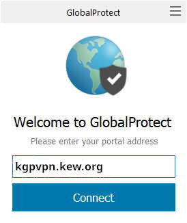
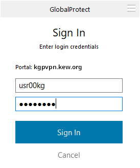

# Remote Access

To access hpcstorage remotely you'll need to connect via Kew's VPN. To connect from MacOS or Windows you'll need the Global Connect VPN client

This is the standard Kew VPN, it will also give access to shared drives and other services located at Kew.There is also a VPN to the Wakehurst Site, to use it replace `kgpvpn.kew.org` with `wgpvpn.kew.org`

For support relating to Kews VPN contact [IT services](mailto:support@kew.org)

## installation and connecting

To get the client:
1. go to [kgpvpn.kew.org](https://kgpvpn.kew.org)
2. log in with your kew username and password
3. Download and Install the Global Protect Client version for your OS
4. Run the Client and enter the Portal name `kgpvpn.kew.org

The enter your Kew username and password and "Sign In".

