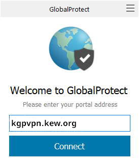
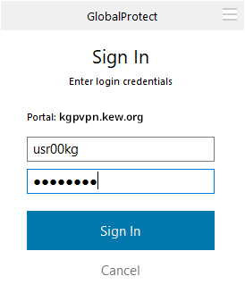

# Remote Access

To access hpcstorage remotely you'll need to connect via Kew's VPN. Using the VPN with connectong to the Crop Diversity HPC allows the use of a password or Key authentication with out 2FA.

This is the standard Kew VPN, it will also give access to shared drives and other services located at Kew.There is also a VPN to the Wakehurst Site, to use it replace `kgpvpn.kew.org` with `wgpvpn.kew.org`

For support relating to Kews VPN contact [IT services](mailto:support@kew.org)

## Installation

To connect from MacOS or Windows you'll need the Global Connect VPN client

1. Go to [kgpvpn.kew.org](https://kgpvpn.kew.org)
2. Log in with your kew username and password
3. Download and install the Global Protect client version for your OS
4. Run the Client

## Connecting 

Enter the portal name `kgpvpn.kew.org`

Then enter your Kew username and password and "Sign In".

